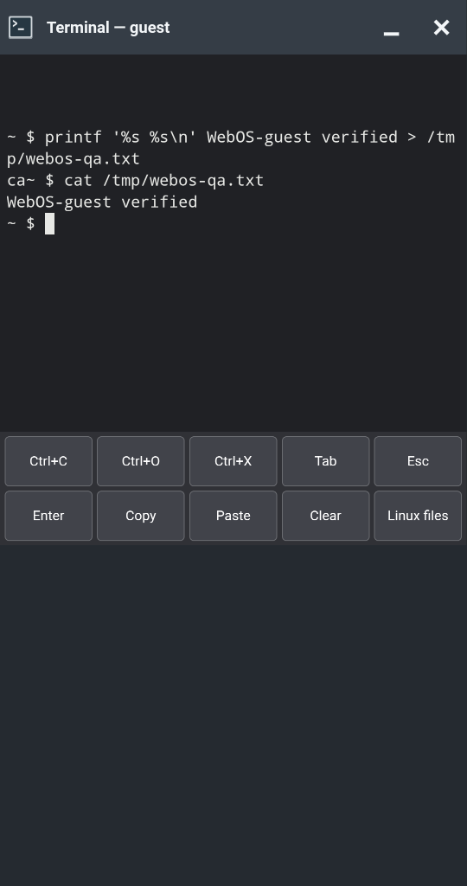
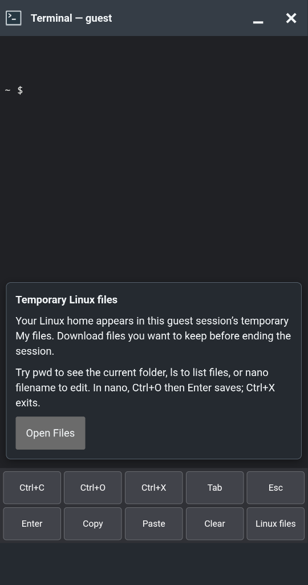
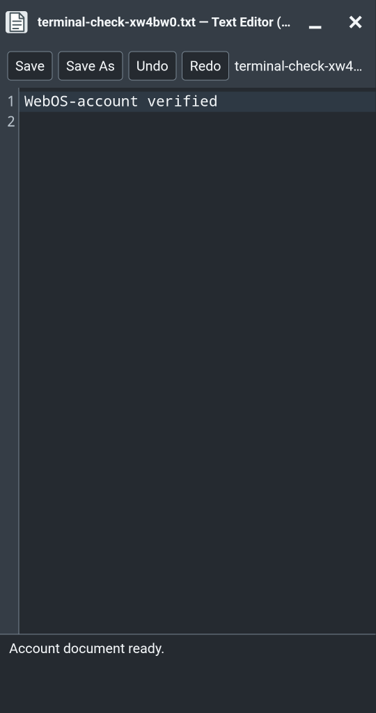

# Terminal on WebOS

November 26, 2026. Tested on a physical Galaxy S10+ with Chrome 158.0.8127.92 at 411 CSS pixels and in Chromium 158.0.8127.36 at 820 and 1300 CSS pixels. The guest test used ksu.codes. The signed-in test used a disposable loopback account with the same viewer.

## Open a Linux shell and keep a file

1. Open **Programming → Terminal**. Wait for the guest prompt. A cold start can take longer than opening an ordinary WebOS app.
2. Tap the terminal, type the following lines and wait for the prompt after each line. Use the keyboard or the **Enter** button.

   ```sh
   printf '%s\n' 'WebOS terminal verified' > /tmp/webos-qa.txt
   cat /tmp/webos-qa.txt
   ```

3. Select **Linux files** for the storage guide. When signed in, Linux home uses My files. For guests, it uses temporary My files. Open Files from the guide to download anything you want to keep.
4. Sign in to a disposable WebOS account, repeat the write with `"$HOME/webos-qa.txt"` and close Terminal. Open **My files** after a fresh sign-in. The saved text opens in Text Editor with the exact bytes.
5. Run `seq 1 100` and drag downward inside the terminal to read earlier output. On the S10+, the on-screen keyboard reduced the viewport from 724 to 481 CSS pixels. The 44-pixel Enter control stayed visible above it.







## Workflow coverage

| Workflow | Physical S10+ | Desktop Chromium |
| --- | --- | --- |
| Boot the v86 Linux guest and run commands | Passed | Passed |
| Use temporary storage and verify reload lifetime | RAM file write/read passed | Passed, including a fresh guest after reload |
| Reopen a signed-in Linux home file from My files | Passed | Passed |
| Enter commands with a usable viewport and PTY geometry | Passed with the keyboard open | Passed, including matching `stty size` after resize |
| Read terminal scrollback through native input | Passed by touch | Passed by mouse wheel |
| Use independent terminals and close one without ending the other | Pending | Passed |
| Edit and save a file in nano with the Terminal controls | Pending | Passed |
| Interrupt a command and clear scrollback | Pending | Passed |
| Identify storage mode and open Files from the guide | Passed in both roles | Passed in both roles |
| Download an exact copy from a guest Linux home | Pending | Passed |
| Copy and paste with a granted browser clipboard | Pending | Pending. The headless clipboard read timed out. |
| Dictate or enter composing text through the IME | Pending | Pending |

Five of twelve phone workflows and ten of twelve desktop workflows passed. The first phone observation ended during cold boot. The extended replay reached the Linux prompt. The user accepted cold-start latency.

## Build and release

WebOS uses the default app builder for `apps/terminal/index.mjs`, with xterm.js, Fit and Serialize, plus `terminal.css`. The assembly's `scripts/build_terminal.mjs` packages the pinned Linux image, v86 runtime, account-home bridge and license files. The Linux image SHA-256 is `2775c554c03a120e8493789ae542d96731a16d2b17dc000bfce1c90288530de3`. The staged renderer matched all eight previous payload entries before the guide change. All twelve changed paths matched the hosted release. The existing Terminal startup assertion also passed.

Runtime source `d8c2271dbbc5658c3ddcdc79a3b148271bfacf63` and viewer `0d6e25894d6c740ba41ef51035d930fa8c0587f75d2d2cca28fd86f67b69214e`.
